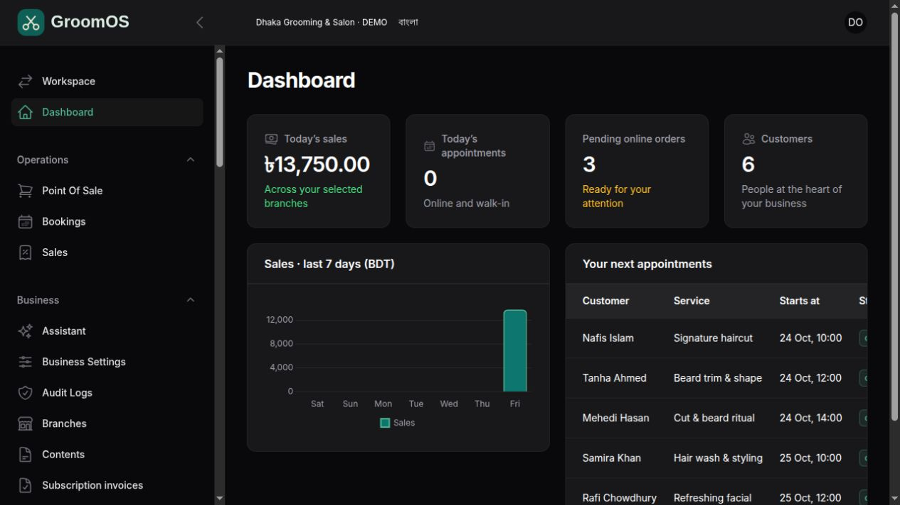
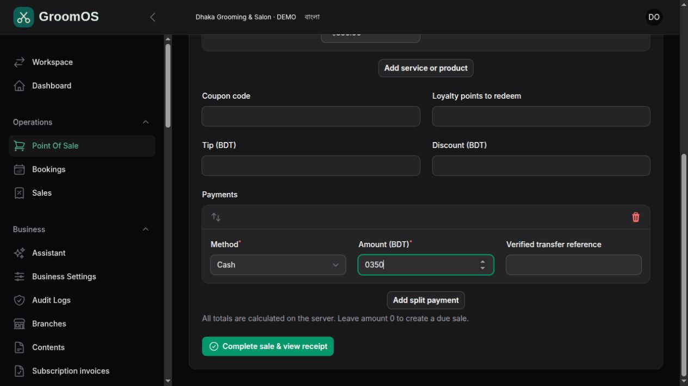
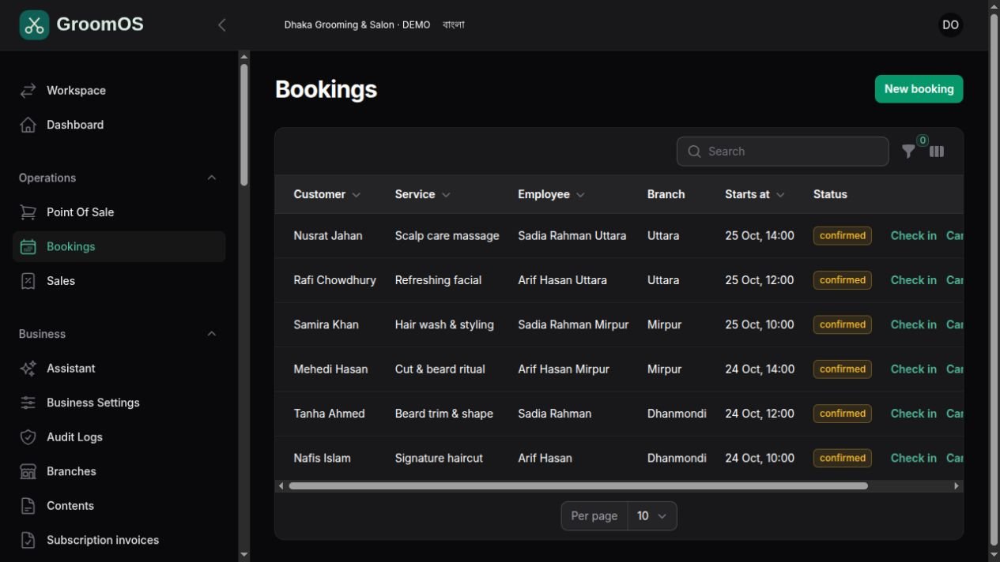
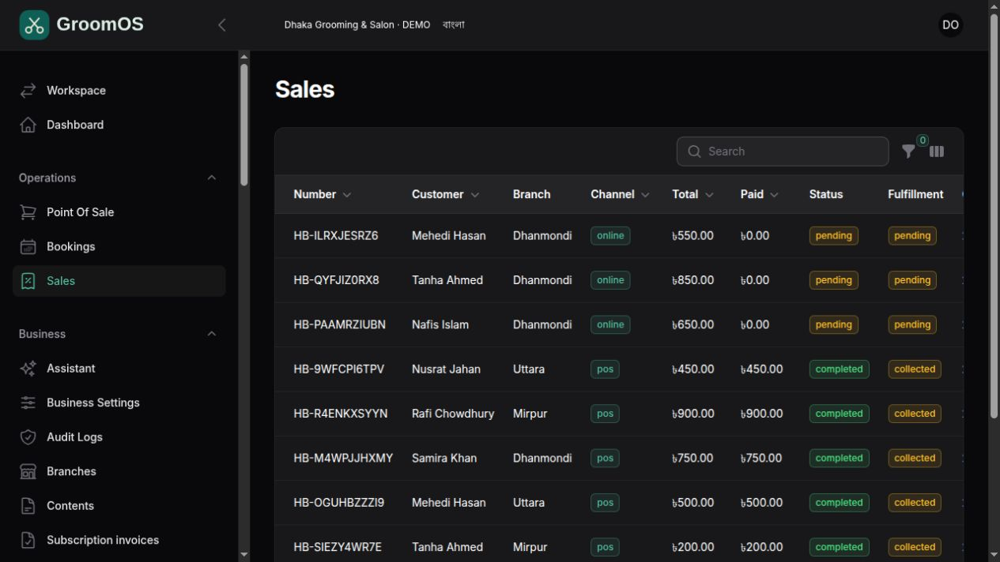
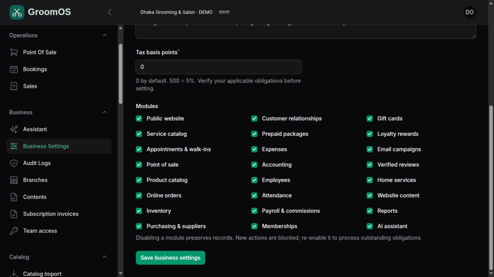
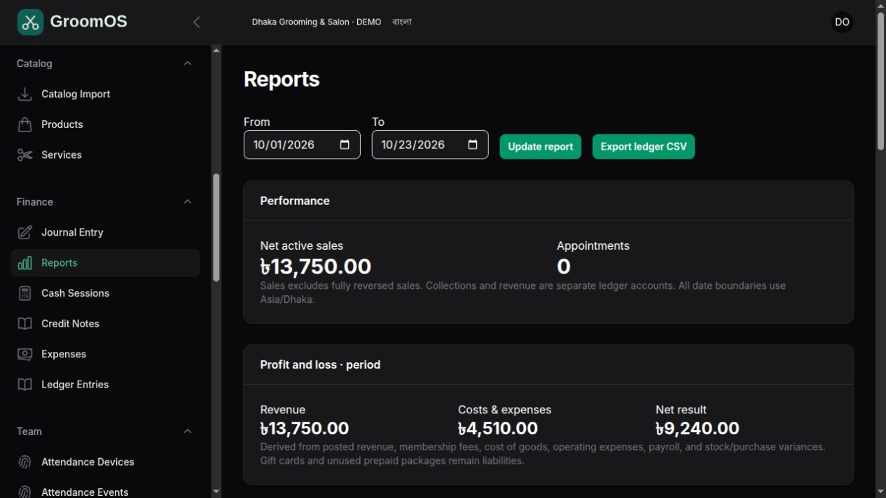
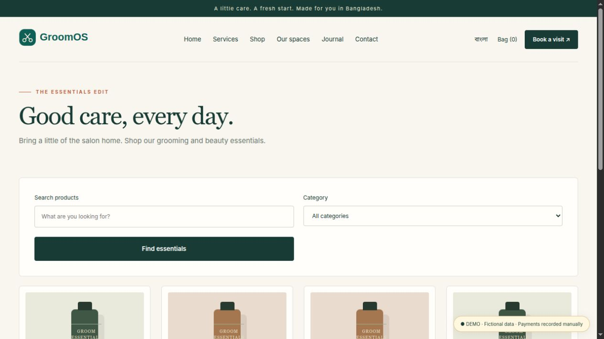
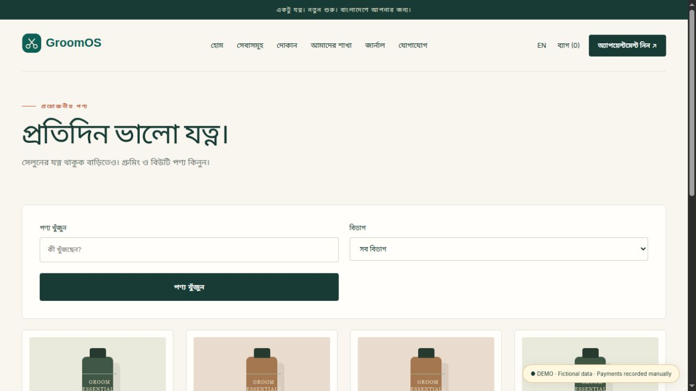
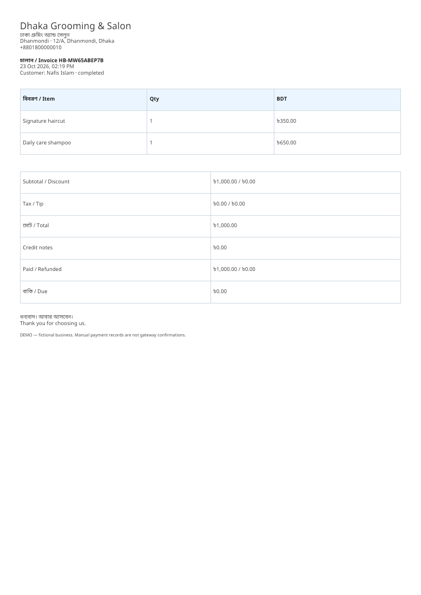
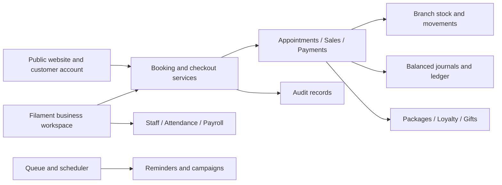

<div align="center">


# More time for your craft. More control over your business.

### A connected workspace for Bangladesh’s barbershops, salons & beauty studios

**Appointments · POS · Online shop · Inventory · Team · Accounting · Multi-branch**

[](https://laravel.com)
[](https://filamentphp.com)
[](composer.json)
[](lang/bn.json)
[](#made-for-bangladesh)
[](docs/acceptance.md)

[Explore the experience](#see-the-application) · [Business benefits](#what-this-changes-for-your-business) · [Features](#feature-guide) · [Try the demo](#try-the-demo) · [Install](#run-it-locally) · [Contact](#-lets-connect--collaborate)

**একটি প্ল্যাটফর্মে আপনার সেলুনের বুকিং, বিক্রয়, স্টক, কর্মী ও হিসাব।**

</div>


> GroomOS connects the customer’s first visit to your website with the appointment, service, sale, stock movement, payment, and business records that follow. Start with a simple barber workspace. Enable more modules as your business grows.
>
> **Current release:** a runnable application with seeded demos and tested operational workflows. Live payment gateways, SMS, and several advanced capabilities are outside this release; see [release boundaries](#release-boundaries--future-opportunities). Screenshots show fictional demo businesses, customers, and transactions.

## Why GroomOS exists

A growing salon can end up managing appointments in a notebook, sales in a calculator, customers in a phone, products in a spreadsheet, and staff commissions in another notebook. Every extra handoff means another opportunity to repeat work or lose a detail.

GroomOS brings those working records together. A receptionist can find an appointment, a stylist can complete the service, a cashier can issue a bill, and an owner can review the result in the same system. Product sales update stock. Payments update receivables. Returns create traceable credit notes. A second branch works inside the same business without sharing its records with another business.

**The opportunity: spend less time reconstructing what happened, and more time improving the customer’s next visit.**

## Who can use it?

| Business | A practical starting setup | Opportunity |
| --- | --- | --- |
| One-chair barber | Services, POS, customers, reports | Replace handwritten bills and end-of-day addition |
| Neighborhood barbershop | POS, appointments, employees, cash register | Coordinate walk-ins and bookings with fewer handoffs |
| Men’s grooming studio | Services, packages, products, loyalty | Offer a repeat-care routine and retail essentials |
| Women’s beauty parlor | Appointments, staff, memberships, packages | Keep visits and prepaid care in one customer history |
| Unisex salon | Staff assignments, service categories, branches | Organize different teams and service menus |
| Bridal or beauty studio | Appointments, packages, home-service requests | Track consultations and prepaid visits; advanced event/resource scheduling is a future extension |
| Salon with a product counter | Storefront, online orders, inventory, purchasing | Sell services and products through connected records |
| Home-service operator | Customer address, stylist booking, travel buffer | Record off-site work; service areas and travel fees are confirmed manually |
| Multi-branch chain | Branch workspace, transfers, consolidated reporting | Compare locations and move stock with a record of dispatch and receipt |
| Software operator / agency | Business isolation, roles, manual subscription invoices | Build a managed offering around onboarding, hosting, support, and customization |

## What this changes for your business

| Daily challenge | Connected workflow | Practical benefit |
| --- | --- | --- |
| Repeating service prices on every bill | Select catalog services and products; server calculates prices and tax | Less repeated calculation |
| Two customers choosing one stylist’s time | Availability checks and transactional booking conflict protection | Fewer preventable scheduling collisions |
| Asking several people where an online order stands | Shared order and fulfillment statuses | A clearer next action for reception and fulfillment |
| Selling the last product online and at the counter | Both channels use the same branch stock and transaction service | Reduced overselling risk |
| Counting products without knowing why stock changed | Movement ledger, purchasing, transfers, returns, and adjustments | Traceability for stock differences |
| Calculating commissions from memory | Staff assignment and commission snapshots on sale lines | More consistent commission records |
| Treating all cash received as profit | Separate receivables, payment accounts, revenue, costs, and prepaid liabilities | More useful financial visibility |
| Losing track of prepaid visits | Package balance, expiry, and redemption history | Easier reception conversations |
| Rewarding customers in a separate notebook | Loyalty earning, redemption, and reversal entries | A visible rewards history |
| Calling each branch to collect daily figures | Authorized branch workspace and consolidated reports | Faster owner review |
| Paying for operational complexity too early | Business module switches and setup presets | A smaller workspace for a smaller shop |
| Manually preparing Bengali receipts | Browser receipt, thermal layout, and Unicode PDF output | Consistent printed documents |

### How much time could it save?

Time savings depend on visit volume, staff training, hardware, and the process you replace. The following is **an illustrative planning example, not a measured benchmark or guaranteed outcome**.

| Example activity | Daily volume assumed | Time saved assumed | Example saving |
| --- | ---: | ---: | ---: |
| Recording bookings and retrieving customer details | 12 bookings | 2 minutes each | 24 minutes/day |
| Preparing bills and updating associated records | 40 bills | 1 minute each | 40 minutes/day |
| Gathering daily sales, dues, and branch figures | 1 daily review | 15 minutes | 15 minutes/day |
| Updating a routine stock worksheet | 1 daily update | 10 minutes | 10 minutes/day |
| **Illustrative total** | | | **89 minutes/day** |

At 26 working days, those assumptions equal **about 38.6 staff-hours per month**. Measure your own before-and-after times during a pilot; avoid counting the same task twice. The aim is to give time back to customer service, staff coaching, stock planning, and business development.

A simple formula for your own estimate:

```text
Monthly time saved (hours)
= Σ(daily task volume × minutes saved per task) × working days ÷ 60
```

### Opportunities beyond saving time

- **Make the business easier to discover:** a public service menu, branch information, contact form, and customer-facing shop.
- **Create a path to repeat visits:** prepaid packages, memberships, and a visible loyalty balance.
- **Build a retail revenue stream:** sell grooming essentials through the counter and online store.
- **Make gifting possible:** issue gift cards and accept them as tender.
- **Support consent-based re-engagement:** queue email campaigns and provide an unsubscribe path.
- **Build trust through experience:** collect reviews tied to completed, fully paid transactions and moderate them before publication.
- **Make expansion easier to organize:** add branches, assign teams, transfer stock, and review shared reports.
- **Develop a service business around the software:** installation, data setup, customization, staff training, managed hosting, and support are potential offerings. The repository does not promise customers, income, or a turnkey hosted SaaS service.

## See the application

All images below come from the running application. They are screenshots, not conceptual product mockups.

### Your business at a glance

Sales, pending online orders, customer count, a seven-day sales chart, and upcoming appointments provide a starting point for the day. Figures follow the selected business and authorized branch scope.



### One checkout for services and products

Choose a branch, add services or retail items, assign a stylist, apply eligible benefits, record split payment, and open the receipt.



<details>
<summary><strong>More screenshots: bookings, orders, modules, reports, shop, and Bengali documents</strong></summary>

#### Reception and appointments



#### Online orders and counter sales



#### Enable the modules your business needs



#### Financial visibility



#### Your product storefront



#### A customer experience in Bengali



#### Bengali and English invoice PDF



[Open the sample PDF](docs/sample-receipt.pdf). It contains fictional demo records.

</details>

## Feature guide

### Public website and customer experience

- Business-specific public website under `/b/{business-slug}`.
- Home, service list, service detail, product list, product detail, branch/team directory, journal/blog, contact, and editable content pages.
- Demo About, Gallery, FAQ, Privacy/Terms, and Cancellation/Delivery content. Policy pages are templates for owner review.
- English/Bengali language preference; optional Bengali names for businesses, services, and products.
- Product search, category filtering, product bag, and quantity selection.
- Customer registration, sign-in, sign-out, and password-reset flow.
- Customer account with appointment history, orders, receipts, loyalty balance, and prepaid packages.
- Branch/stylist selection, booking confirmation, availability lookup, and eligible cancellation from the account.
- Pickup or manually arranged local delivery, order details, fulfillment progress, and branch contact information.
- Contact enquiries available to the business team.
- Verified reviews submitted by eligible customers and published after moderation.
- Responsive layouts, server-rendered pages, meaningful empty states, and local illustration/font assets.

### Services, appointments, and walk-ins

- Service categories, descriptions, prices, durations, and cleanup buffers.
- Active/inactive services and employees.
- Staff branch assignments, working days, shift hours, and time-off/break intervals.
- Reception bookings and walk-in source tracking.
- Public availability lookup at 15-minute intervals; final availability is checked again when a booking is submitted.
- Conflict protection for overlapping bookings assigned to the same employee.
- Status flow: confirmed → checked in → in service → completed, with eligible cancellation and no-show actions.
- Upcoming appointment dashboard and searchable, branch-filterable booking records.
- Completed appointment billing in POS, with the booked service price retained.
- Prevention of billing an appointment twice or billing an appointment already redeemed through a package.
- Customer self-cancellation more than two hours before the scheduled visit.
- Home-service address recording and a fixed 30-minute travel buffer when the module is enabled.
- Queueable appointment reminder emails with delivery deduplication records.

**Current scheduling scope:** one service and one assigned stylist per booking. Room/equipment capacity, multi-service sequencing, rescheduling UI, deposits, and automatic walk-in wait estimates are future work.

### POS, payments, and receipts

- Mixed service/product sales with server-side price lookup.
- Walk-in sales or an identified customer.
- Staff assignment per line and commission snapshots.
- Owner/admin manual discounts; coupon and membership benefit calculation.
- Loyalty redemption capped at 20% of subtotal; optional tip recording.
- Configurable tax in basis points; tax defaults to zero.
- Cash, bank, manually verified bKash/Nagad/Rocket records, and gift-card tender.
- Split payments, due sales, subsequent collection, and overpayment rejection.
- Payment idempotency keys and transactional rollback when checkout cannot complete.
- Full cancellation/refund and quantity-based partial returns.
- Credit-note records, proportional discount/tax allocation, stock restoration for returned retail products, and refund allocation against original payments.
- Loyalty, coupon, gift balance, commission, and accounting adjustments on returns.
- Browser receipts, an 80mm print-layout toggle, and downloadable A4 Bengali/English PDFs.
- Cash register opening float, close, expected cash, counted cash, and variance audit.

**Payment distinction:** bKash, Nagad, Rocket, and bank transfers are recorded after manual verification. This release does not perform an automatic mobile-wallet charge, gateway settlement, or live bank refund. Recording a refund is a business record; an operator must complete any external money movement.

### Online orders

- Shared product catalog and branch inventory with POS.
- Account-based checkout; stock is deducted when the order is placed.
- Pending order list and independent payment/fulfillment information.
- Processing → ready → collected, or processing → dispatched → delivered workflows.
- Payment completion required before collected/delivered status.
- Pickup and manually confirmed local delivery addresses.
- Customer order details and receipts.
- Cancellation/return workflow through authorized staff.

**Current fulfillment scope:** no courier API, automated delivery-zone calculation, or partial shipment workflow. Online orders commit stock immediately; they do not use expiring payment reservations.

### Products, stock, purchasing, and branches

- Products, SKUs, categories, descriptions, bilingual names, retail price, and standard cost.
- Per-branch stock balances and stock movement records.
- No negative stock through normal sale/adjustment workflows.
- Concurrent checkout protection for the last available unit.
- Suppliers and single-product purchase orders.
- Partial receiving; receipt quantities cannot exceed the remaining ordered quantity.
- Purchase receipt accounting with standard inventory cost and purchase-price variance.
- Branch stock transfers: request, dispatch into transit, and receive at the destination.
- Stock adjustments with reasons and explicit posting.
- Service consumable recipes using whole stock units; consumption on service sale or package redemption.
- Product returns restore eligible quantities and reverse the associated retail cost.
- Standard cost changes are blocked while stock is held.
- Configurable reorder thresholds and a stock view; automated replenishment is not included.

**Current stock scope:** single SKU per product, whole-unit stock, standard costing, whole-transfer receiving, and one product per purchase order. Variants, batch/expiry tracking, fractional unit conversions, purchase returns, and barcode-scanning UI are future extensions.

### Customer retention and marketing

| Capability | What the application does |
| --- | --- |
| Customer records | Contact information, notes, marketing consent, visit and purchase links |
| Loyalty | Earn 1 point per BDT 100 of invoice value excluding tips; redeem 1 point as BDT 1, subject to the 20% cap |
| Prepaid packages | Service-specific uses, validity, issue price snapshot, remaining balance, and redemption ledger |
| Memberships | Fixed term, benefit percentage snapshot, active/cancelled benefits, and automatic eligible discount |
| Gift cards | Secure random code, issue value, remaining balance, expiry, optional named customer, and refund restoration |
| Coupons | Code, percentage, use limit, expiry, activation, and use-count reversal on a full return |
| Discount policy | Membership/coupon benefits use the greater applicable percentage; manual and automatic discounts do not stack; redeemed points are applied separately |
| Reviews | One review per eligible completed/paid sale, rating, moderation, and public display |
| Campaigns | Consent-filtered email queue, delivery records, and signed unsubscribe confirmation |
| Enquiries | Public contact form and new/in-progress/resolved management |

Packages, memberships, and gift cards are issued after collecting cash; their issuance posts the corresponding business entries. Membership fees are recognized at issuance in this release. Package and gift-card proceeds remain liabilities until redeemed. Automatic recurring membership charging is not implemented.

### Employees, attendance, and payroll

- Employee profiles, titles, branch assignment, salary, and commission percentage.
- Team access accounts with distinct responsibilities.
- Stylist appointment access restricted to the linked employee; demo stylist linkage is seeded.
- Working days, shifts, and leave/break intervals.
- Manual attendance with check-in/check-out and paid-payroll locking.
- Attendance-device records, encrypted credentials, device-user/employee mapping, raw event hashes, and synchronization history.
- Attendance Hub adapter for ZKTeco, Hikvision, Dahua, and Suprema provider selections.
- A working simulated device for a no-hardware demo; repeated synchronization deduplicates raw events.
- Explicit server-side host allowlisting before connecting to real devices.
- Monthly payroll generation with salary, commission, allowance, deduction, and total.
- Paid payroll locking and accounting posting.
- Commission reversal adjustment records when a returned sale had already contributed to paid payroll.

**Current payroll scope:** salary plus sales commissions and explicit adjustments. Attendance does not automatically calculate legal overtime, unpaid leave, statutory deductions, or benefits. Those rules require business-specific implementation and review. Hardware protocols are not live-certified by the tests.

### Finance and reports

- Draft and posted expenses with categories, dates, and payment account.
- Double-entry journals and debit/credit ledger entries.
- Sale, receipt, refund, stock cost, purchasing, transfer, package, gift-card, expense, and payroll postings.
- Manual balanced journal entry for opening balances, capital, supplier payments, tips payouts, cash in/out, and corrections.
- Net invoice sales, branch comparison, appointment count, staff commission figures, period ledger movement, profit-and-loss summary, and trial balance.
- Branch/date filtering, BDT display, and Asia/Dhaka date boundaries.
- Authorized CSV ledger export with spreadsheet-formula prefix protection.
- Financial journal balance check with `php artisan salon:check`.

**Accounting policy:** invoices, including committed online orders, post revenue at creation in this release. The profit-and-loss screen reflects posted entries; it is not a delivered-goods revenue recognition engine or statutory reporting product. Dedicated cash-flow/balance-sheet statements, bank-feed reconciliation, and regulatory submissions are not included. Use an accountant to validate your actual accounting policies and opening balances.

### Multiple businesses, branches, roles, and modules

- Business-level record isolation and scoped operational models.
- Owners can choose an authorized branch or view consolidated records.
- Branch users remain restricted to their assignment.
- Platform administrators select a business workspace explicitly; selection is audited.
- Module registry with dependencies, plan entitlements, business switches, and applicable branch restrictions.
- Presets for a basic barber, appointment salon, retail salon, or full studio/chain.
- Basic-plan entitlements and broader professional/enterprise entitlements.
- Disabled modules preserve records; relevant resource screens and new workflows are blocked. Re-enable a module to process its outstanding obligations.
- Audit records for important operational transitions, payments, returns, settings, workspace selection, exports, and posting workflows.
- Platform business management, manual subscription invoices, payment-reference confirmation, period end, grace days, and scheduled suspension.

**Roles:** platform administrator, owner, business administrator, branch manager, receptionist, cashier, stylist, inventory officer, accountant, HR/payroll manager, and customer. Permissions are defined in code; a custom-role permission builder is a future extension. See [permissions](docs/permissions.md).

### AI, imports, and requested packages

AI is optional. The demo runs without paid AI credentials.

- Draft marketing copy in English or Bengali through AI Hub.
- Product draft generation using AI Catalog data structures and AI Hub.
- Pasted permitted source text or a controlled HTTPS URL import.
- Review/edit generated title, description, SKU, category, and price before saving an **inactive** product.
- Duplicate SKU checks, import provenance in audit records, request rate limits, and escaped output.
- URL allowlisting, public-IP validation, pinned DNS resolution, no redirects, a response-size limit, and timeouts.
- Source text is treated as untrusted input; generated content is never automatically published.

| Requested package | Application use / exact boundary |
| --- | --- |
| [`imrandevbd/drutogoti`](https://packagist.org/packages/imrandevbd/drutogoti) | Registered performance instrumentation; disabled by default. No unmeasured speed improvement is claimed. Publish its migrations before enabling capture. |
| [`imrandevbd/laravel-admin-panel`](https://packagist.org/packages/imrandevbd/laravel-admin-panel) | Shared package palette definitions used by the Filament panel. Its separate admin routes/auth system are deliberately not registered. |
| [`imrandevbd/laravel-ai-catalog`](https://packagist.org/packages/imrandevbd/laravel-ai-catalog) | Generation input/listing structures and a hardened subclass of the URL reader, inside the app’s authorized import page. Package-wide Studio/API routes are not exposed. |
| [`imrandevbd/laravel-ai-hub`](https://packagist.org/packages/imrandevbd/laravel-ai-hub) | Marketing/product copy requests, demo fakes, provider abstraction. Global package settings UI is disabled. |
| [`imrandevbd/laravel-attendance-hub`](https://packagist.org/packages/imrandevbd/laravel-attendance-hub) | Device manager, provider drivers, connection/punch DTOs, and simulator; app-owned scoped records and sync workflow. Automatic discovery and unauthenticated device push routes are not enabled. |
| [`imrandevbd/laravel-unicode-pdf`](https://packagist.org/packages/imrandevbd/laravel-unicode-pdf) | Actual Bengali/English receipt PDF generation using local Noto fonts. |
| [`imrandevbd/laravel-universal-slug`](https://packagist.org/packages/imrandevbd/laravel-universal-slug) | Unicode-safe slugs during installation, demo catalog seeding, and catalog import. |

Laravel **12.70.1**, Filament **3.3.57**, and AI Hub **1.6.0** were installed during verification. Other requested packages currently use explicit development-release constraints pinned to exact revisions in `composer.lock`; review them before upgrading. See [integration details](docs/integrations.md).

## Made for Bangladesh

| Detail | Support |
| --- | --- |
| Language | Bengali/English public interface, Bengali catalog names, Filament’s available Bengali translations; some custom admin copy remains English |
| Currency | BDT / ৳, stored as integer paisa |
| Time | UTC storage, Asia/Dhaka customer/admin scheduling and report boundaries |
| Mobile numbers | Bangladeshi registration input with normalization to international format |
| Payment habits | Cash, bank records, manually verified mobile-wallet records, split and due payments |
| Documents | Bengali/English browser receipts and Unicode PDF invoices |
| Branch operations | Different addresses, contacts, opening hours, staff, stock, and module restrictions |
| Taxes | Configurable basis points, default zero; no assumed legal rate |
| Connectivity | Server-rendered public experience; an internet/server connection is required for transactions |

## Try the demo

After the local installation below:

| Experience | Local path |
| --- | --- |
| Platform introduction and demo businesses | `/` |
| Business administration | `/admin/login` |
| Multi-branch salon | `/b/dhaka-grooming` |
| Basic single-branch barber | `/b/classic-barber` |
| Beauty studio | `/b/rong-beauty` |
| Customer sign-in | `/b/dhaka-grooming/login` |
| Customer account | `/b/dhaka-grooming/account` |

The demo contains **three fictional businesses and five branches**, services, products, stock, suppliers, customers, upcoming appointments, POS sales, pending online orders, expenses, attendance, payroll drafts, packages, gift cards, coupons, membership plans, review samples, and a campaign draft.

### Demo accounts

**Local demo password:** `DemoSalon2026!` — configurable with `DEMO_PASSWORD` before seeding.

| Role | Email | Typical task |
| --- | --- | --- |
| Platform administrator | `platform@example.test` | Choose a business workspace; manage businesses/subscription invoices |
| Multi-branch owner | `owner@example.test` | All Dhaka salon operations and consolidated reports |
| Branch manager | `manager@example.test` | Dhanmondi operations |
| Receptionist | `reception@example.test` | Bookings, customer records, orders |
| Cashier | `cashier@example.test` | Dhanmondi POS, collections, register |
| Stylist | `stylist@example.test` | Linked stylist’s appointments |
| Inventory officer | `inventory@example.test` | Catalog, stock, purchasing |
| Accountant | `accounts@example.test` | Finance, reports, payroll |
| HR/payroll | `hr@example.test` | Employees, attendance, payroll |
| Customer | `customer@example.test` | Public booking, shopping, account |
| Second business owner | `owner2@example.test` | Basic Chattogram barber workspace |
| Beauty studio owner | `beauty@example.test` | Rong Beauty Studio workspace |

Demo seeding and reset are forbidden when `APP_ENV=production`. Never use these publicly documented accounts on a live business database.

### A ten-step tour

1. Open the salon website and explore services, branches, the shop, and Bengali mode.
2. Sign in as the customer and book an available service with a stylist at the correct branch.
3. Sign in as reception/owner and move the visit through check-in, in service, and completed.
4. Open **Bill in POS**; confirm the completed booking’s service and customer.
5. Record cash or split payment and inspect the receipt/PDF.
6. Place an online product order as the customer; find the pending order in **Sales**.
7. Collect the due amount, process the order, and mark it ready/collected or dispatched/delivered.
8. Try a partial return and inspect the credit note, stock movement, payment reversal, and customer rewards.
9. Receive a purchase, transfer stock, issue a package/gift card, or sync the simulated attendance device.
10. Review reports and module switches. Compare the basic barber workspace with the full salon workspace.

See the [detailed walkthrough](docs/demo-walkthrough.md).

## Run it locally

### Requirements

- PHP **8.3+**; this workspace was verified with PHP 8.5.4.
- Composer 2.
- Node.js **22.12+** and npm for the Vite 8 build.
- SQLite for a quick demo; MySQL/MariaDB for a deployed installation.
- PHP extensions required by the locked dependencies, including PDO SQLite/MySQL as applicable, mbstring, intl, DOM/XML, ctype, fileinfo, curl, zip, and bcmath. Check `composer check-platform-reqs`.
- A queue worker and scheduler for queued campaigns and reminders.

### Quick start: local demo

Run from the repository root:

```bash
composer install
cp .env.example .env
php artisan key:generate
php -r "file_exists('database/database.sqlite') || touch('database/database.sqlite');"
```

In `.env`, set:

```dotenv
APP_ENV=local
APP_URL=http://localhost:8000
DB_CONNECTION=sqlite
SALON_DEMO=true
DEMO_PASSWORD=DemoSalon2026!
MAIL_MAILER=log
SALON_AI_LIVE=false
```

Then:

```bash
php artisan migrate --seed
npm ci
npm run build
php artisan serve --host=127.0.0.1 --port=8000
```

Open **[http://localhost:8000](http://localhost:8000)**. In separate terminals:

```bash
php artisan queue:work --tries=1
```

```bash
php artisan schedule:work
```

Local emails go to `storage/logs/laravel.log`. Demo AI returns clearly labeled simulated copy. Simulated attendance requires `SALON_DEMO=true`.

### Real business setup without demo data

Use an empty database, set `SALON_DEMO=false`, run migrations **without** `--seed`, then:

```bash
php artisan salon:install
```

The interactive command asks for the first business and owner account, including a hidden password prompt. Configure the branch, services, staff, and website content before enabling the public website. Add more businesses through a platform administrator account managed by your deployment operator.

### Useful commands

| Command | Purpose |
| --- | --- |
| `php artisan salon:check` | Check that posted journals balance |
| `php artisan salon:reminders` | Queue eligible appointment reminder emails |
| `php artisan salon:subscriptions` | Apply expiration/grace-period suspension |
| `php artisan salon:demo-reset --force` | **Destructively rebuild** the configured non-production database and reseed the demo |
| `php artisan queue:failed` | Inspect failed Laravel jobs |
| `php artisan optimize:clear` | Clear stale application caches |
| `composer test` | Run automated tests |
| `npm run build` | Generate production frontend assets |

## Configure integrations

### Live AI

Keep demo mode for local evaluation. For a real provider, set `SALON_AI_LIVE=true`, configure the appropriate key/provider/model from the AI Hub package documentation, and use a currently available model for your account. Example environment keys are in `.env.example`. No key is bundled. The app rate-limits draft/import generation per user. Review provider data handling and costs before enabling it.

### Permitted catalog sources

Set exact comma-separated hosts in `SALON_IMPORT_HOSTS`. Only authorized HTTPS HTML sources are accepted; private/reserved addresses, custom ports, redirects, and oversized responses are rejected. Respect content rights and source terms. Pasted text works without network scraping.

### Attendance machines

Create an **Attendance Device** with a provider, host, port, credentials if needed, and device-user IDs mapped to employee database IDs. Add the exact host to `SALON_ATTENDANCE_HOSTS` before a live connection. Use the simulated provider to inspect the workflow first. Compatibility depends on the actual model, firmware, network, and package driver; validate against a real machine before relying on payroll input.

### Email

Configure Laravel’s mail transport and supervise the queue. Campaigns target consenting customers with email addresses. Delivery records mean the app handed the message to the configured transport; they are not proof of inbox delivery. An uncertain transport outcome is marked for review rather than automatically retried into possible duplicate mail.

### Performance instrumentation

Drutogoti is registered but capture is disabled by default. Publish its configuration/migrations and review what it records before enabling it. Instrument a controlled workload before claiming a speed gain. Business transaction consistency does not depend on its capture layer.

## Verification and engineering

The application uses a Laravel modular monolith: scoped models, domain services, Filament resources/pages, Blade storefronts, queued jobs, and database transactions.



### Checks performed

- **30 automated tests / 170 assertions passed on SQLite.**
- **The same 30 tests / 170 assertions passed on MariaDB 11.8.6.**
- Separate MariaDB process-race checks passed for simultaneous last-item checkout and same-stylist booking.
- Production Vite build completed.
- Public and owner pages exercised through HTTP/Livewire tests.
- Browser sign-in and representative public/admin screens inspected.
- Actual Bengali PDF generated, rendered, and visually inspected.

These are development verification results from **23 October 2026**, not a production certification or ongoing hosted-service SLA. See [acceptance evidence](docs/acceptance.md) for scope and limitations.

### Re-run the tests

```bash
php artisan test
vendor/bin/pint --test
npm run build
```

The default test configuration uses an isolated in-memory SQLite database. To test MySQL/MariaDB, point PHPUnit at a **dedicated disposable test database**, never the live database. For simultaneous-request verification, `scripts/check-concurrency.php` refuses to run unless the MySQL database is named exactly `haircut_concurrency_test`; it rebuilds that database and requires `ext-pcntl`.

### Security and integrity highlights

- Business scopes, branch restrictions, role checks, and customer ownership checks.
- Server-side validation and pricing, database transactions, branch/record locks, and uniqueness constraints.
- CSRF protection, hashed passwords, password resets, login throttling, and session regeneration.
- Protected receipt/export endpoints and audited sensitive workflows.
- Encrypted device credentials and no biometric-template collection in the application adapter.
- Controlled URL imports and escaped source/AI content.
- Private package administration routes are not accidentally exposed alongside the business panel.
- No paid-provider credentials or real customer records are included.

For production guidance, read [deployment](docs/deployment.md) and [operations](docs/operations.md). Validate your own security, accounting, privacy, and business requirements before going live.

## Release boundaries & future opportunities

The original [implementation brief](IMPLEMENTATION_PROMPT.md) describes a broader product vision. The following capabilities remain future development or external setup; they are **not advertised as working in this release**.

| Area | Current boundary / opportunity |
| --- | --- |
| Live gateway payments | Merchant onboarding, server-verified gateway adapters, webhook handling, automated settlement/refund integration |
| Messaging channels | SMS, WhatsApp, push notifications, campaign analytics, referral attribution |
| Advanced scheduling | Multiple services per booking, rooms/chairs/equipment, variable travel zones/fees, appointment deposits, booking rescheduling UI, estimated walk-in wait display |
| Retail depth | Product variants, barcode-scanning UI, batch expiry, fractional units, multi-line purchase orders, supplier returns, partial transfer receipts |
| Order logistics | Expiring payment holds, courier APIs, delivery-zone pricing, partial fulfillment |
| Team and payroll | Automatic overtime/leave calculations, statutory payroll rules, advanced commission tiers, full tips distribution, HR document workflows |
| Finance | Delivery-based revenue recognition, statutory VAT reporting, bank-feed reconciliation, dedicated cash-flow/balance-sheet screens, automated financial period closing |
| Platform operations | Self-service tenant signup, custom domains/TLS automation, plan metering, recurring subscription charging, custom role builder, MFA, support impersonation controls |
| Customer records | Profile-edit UI, data export/deletion workflow, loyalty expiry administration, marketing preference center beyond unsubscribe |
| Media and content | Production photo upload/gallery management, richer CMS, automated sitemap/structured-data coverage, complete translation of custom admin copy |
| AI governance | Per-business provider vaults, monetary AI budgets, advanced image/voice/bulk extraction, provider failover certification |
| Connectivity | True offline POS, conflict-aware synchronization, PWA offline transactions |
| Enterprise rollout | Load/soak testing, real hardware/provider certification, accessibility audit, external penetration test, backup restore drills |

A useful next release should follow actual pilot feedback: improve the bottleneck your team can measure, then expand the module. The current architecture provides a place for that work without pretending the work is already done.

## Documentation map

| Document | What it explains |
| --- | --- |
| [Architecture](docs/architecture.md) | Runtime structure and transaction boundaries |
| [Data model](docs/data-model.md) | Business entities and relationships |
| [Modules](docs/modules.md) | Dependencies, presets, plans, and disabled behavior |
| [Permissions](docs/permissions.md) | Roles and branch/customer restrictions |
| [Workflows](docs/workflows.md) | Booking, sale, order, stock, payroll, and return behavior |
| [Integrations](docs/integrations.md) | Package versions, provider setup, and verification limits |
| [Deployment](docs/deployment.md) | Production installation and server configuration |
| [Operations](docs/operations.md) | Queues, scheduler, backup, restore, and incident handling |
| [Demo walkthrough](docs/demo-walkthrough.md) | A guided tour using the seeded accounts |
| [Acceptance evidence](docs/acceptance.md) | Tests and checks actually performed |
| [Original brief](IMPLEMENTATION_PROMPT.md) | Full product vision and advanced acceptance ambitions |

## Contributing and adapting

Start with a real workflow and reproduce it with a test. Keep tenant/branch authorization in place, calculate money on the server, and put posting logic in domain services. Include migrations, demo examples, failure handling, and documentation for a new module. Use sandbox adapters until a live provider can be verified.

Screenshots use original local SVG illustrations, not photographs of a real salon. Local Noto fonts are accompanied by their [font licensing information](public/fonts/LICENSE-NOTO.txt). Third-party packages retain their respective licenses. Application licensing is described in [LICENSE](LICENSE).

---

## 🤝 Let's Connect & Collaborate

I am open to **Senior Remote Full-Stack Roles, AI Platform Architecture Contracts, and Enterprise Technical Advisory**.

**Timezone:** UTC+6 (Dhaka / Rangpur, Bangladesh) — Flexible overlap with US, UK, and European business hours.

**Delivery Mode:** Async-ready, Slack, Discord, Jira, GitHub, and production-first accountability.

| Channel | Address / Handle | Quick Action |
| --- | --- | --- |
| 🌐 Primary Portfolio | [imrandev.bd](https://imrandev.bd) | [Visit Site ↗](https://imrandev.bd) |
| 📦 Packagist Packages | [packagist.org/packages/imrandevbd/](https://packagist.org/packages/imrandevbd/) | [View Packages ↗](https://packagist.org/packages/imrandevbd/) |
| 💼 LinkedIn Profile | [linkedin.com/in/imranbru99](https://www.linkedin.com/in/imranbru99) | [Connect ↗](https://www.linkedin.com/in/imranbru99) |
| 🐙 GitHub Profile | [github.com/imranbru99](https://github.com/imranbru99) | [Follow ↗](https://github.com/imranbru99) |
| 💬 WhatsApp Direct | [+880 1576-918420](https://wa.me/8801576918420) | [Chat Now ↗](https://wa.me/8801576918420) |
| 📧 Direct Email | [me@imrandev.bd](mailto:me@imrandev.bd) | [Send Email ↗](mailto:me@imrandev.bd) |
| 🐦 X (Twitter) | [@imrandev_bd](https://x.com/imrandev_bd) | [Follow ↗](https://x.com/imrandev_bd) |
| 📺 YouTube Tech | [@ImranDevBD](https://www.youtube.com/@ImranDevBD) | [Subscribe ↗](https://www.youtube.com/@ImranDevBD) |
