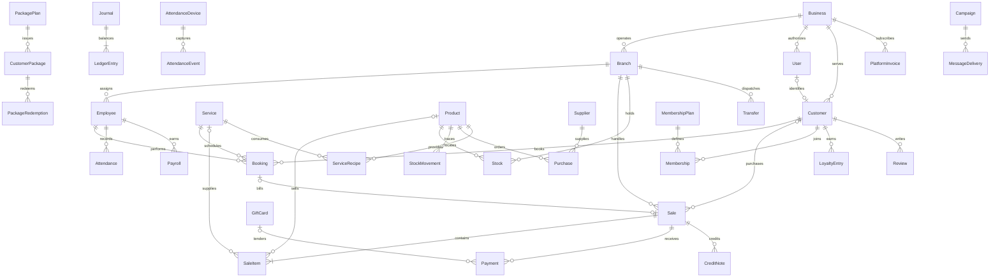

# Data model

All operational entities carry `business_id`; branch-specific entities also carry `branch_id`. Monetary columns store integer paisa. Posted financial data is corrected with new journal/credit records, rather than UI deletion.

## Important uniqueness constraints

- Business slug; tenant-local product SKU/slug and content/service slugs.
- Branch/product stock row.
- Sale idempotency key and receipt token; one sale per booking.
- Payment idempotency key; credit-note idempotency key.
- Journal event key; one package redemption per booking.
- Employee/date attendance; raw attendance event hash; employee/month payroll.
- Tenant coupon code; gift code; review per sale; campaign/customer delivery.

## Snapshots and policies

Sales retain item names, unit prices, standard costs, tax/discount totals, and commissions. Bookings retain service price. Memberships retain benefit percentage and price. Issued packages retain price/remaining uses; service/use-count changes on plans with issued packages are blocked. Product standard cost cannot change while stock is held.

The implementation does not model variants, batch/expiry inventory, multi-line purchase orders, or equipment capacities. Introduce those with explicit migrations and workflow tests rather than overloading existing columns.
